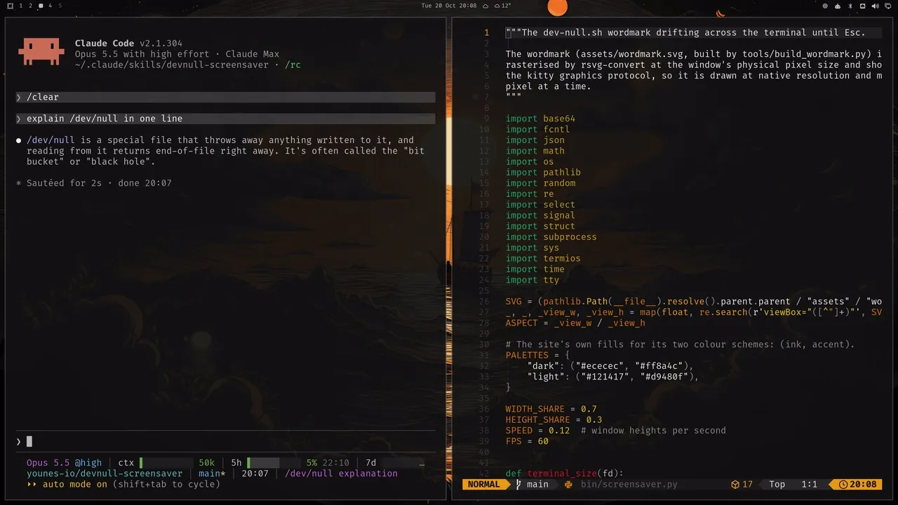

<div align="center">



# devnull

[dev-null.sh](https://dev-null.sh) things for Claude Code. Install the ones you want.

</div>

## Plugins

| Plugin | What it does |
| --- | --- |
| [`screensaver`](#screensaver) | `/screensaver` sends your terminal to /dev/null until you press Esc |

## screensaver

The dev-null.sh wordmark drifts across the terminal that ran the command, in the site's colors, at native pixel resolution. Nothing else on your screen changes.

The screensaver lives on that terminal's workspace. Switch away and it stays behind. Come back and it is still drifting. Press Esc and your session is exactly where you left it.

```
/plugin install screensaver --marketplace younes-io/devnull
```

Answer `y` to add the marketplace, then choose a scope. From a shell, prefix it with `claude`.

| Input | Effect |
| --- | --- |
| `/screensaver` | Cover this terminal |
| Esc, `q`, Ctrl-C | Bring the session back |

Open `/config` and set **Command names** to any list, such as `screensaver, ss, afk`. Each name becomes a slash command. Leave `screensaver` out to replace it.

Needs [Hyprland](https://hyprland.org) 0.56+, [Ghostty](https://ghostty.org), `python3`, and `rsvg-convert` from librsvg.

## Hack on it

Each plugin lives in `plugins/<name>/` and is listed in `.claude-plugin/marketplace.json`.

```
claude plugin validate .
claude plugin validate plugins/screensaver
claude plugin test plugins/screensaver
```

The wordmark is cut from Geist Bold:

```
cd plugins/screensaver
uv run --with fonttools --with brotli --with uharfbuzz tools/build_wordmark.py
```

`plugins/screensaver/tools/promo/` records the demo above on a headless 4K output. `stage.sh` sets the scene, `take.sh` performs it, and `edit.sh` cuts it.

## License

[MIT](LICENSE)
